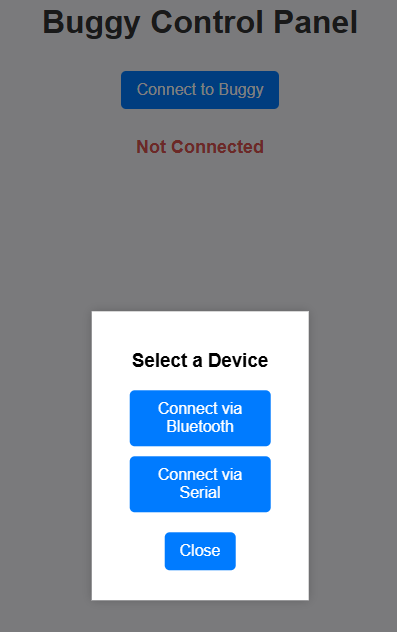
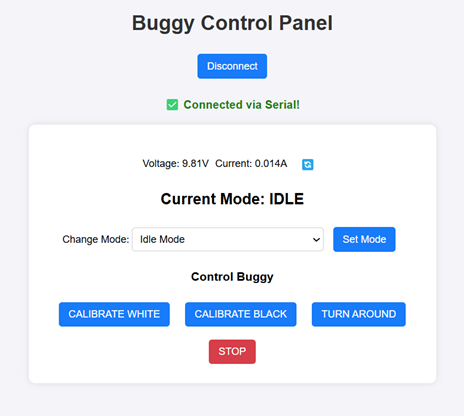
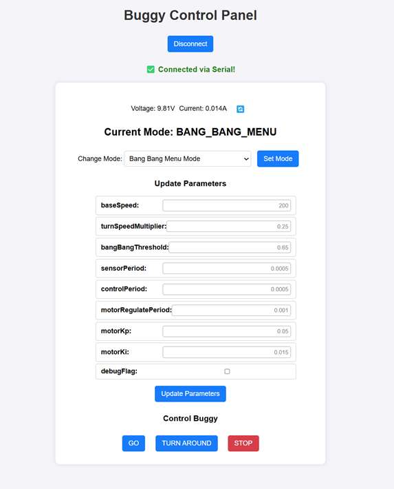
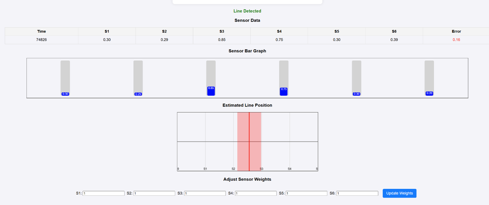
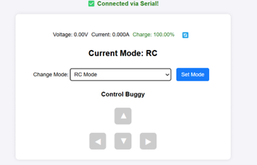
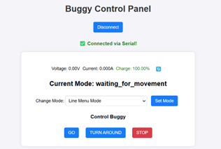
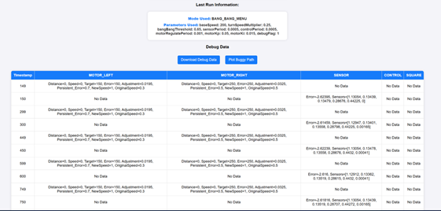
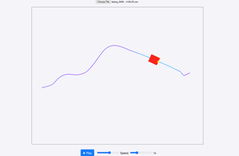
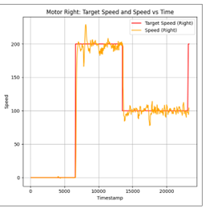

## **ESP Buggy Web App** 🚗💻

A browser-based control and debugging interface for the **ESP Buggy Project (Group 2)**.  
The web app enables **mode switching, real-time parameter tuning, RC control, sensor debugging, and run data visualization**.

Deployed on **Netlify**: [esp-group-2.netlify.app](https://esp-group-2.netlify.app)  

## 🌟 **Features**
- **Serial Connection**: Connect directly to buggy firmware for control & telemetry.
- **Mode Management**: Switch between multiple driving/control modes
- **Parameter Tuning**: Update PID/Bang-Bang parameters live without reflashing.
- **Calibration Tools**: Calibrate black/white values for sensors directly via UI.
- **Debugging Suite**: Plot sensor data, view motor logs, export CSVs.
- **Visualizations**: Route playback and motor speed vs. time plots.

## 📸 **Screenshots**

### Connection Modal

### Idle Menu

### Parameter Adjustment Menu

### Sensor Debugging

### RC Mode

### Waiting for Movement

### Debug Table 

---
## 📊 Example Debug Data
### Run path

### Motor Speed Plot

